# Screen gallery

Every main screen of the Daily Drill page, as it looks today, at phone (375×812) and desktop
(1366×860) size, in the Dusk and Light looks. Each picture says what the learner sees, which code
draws it, and how to change it safely. Use it to find your way around before you open
`page.html`, and to compare after a change.

How the code is organised: [../FRONTEND.md](../FRONTEND.md). Tokens, rules and components:
[../DESIGN_SYSTEM.md](../DESIGN_SYSTEM.md).

## Retake the pictures

After any change you can see, retake them and look at the difference in the PR:

```bash
uv run drill build-page
DRILL_PORT=8791 DRILL_DATABASE_URL=sqlite:///.drill/screens.db uv run drill-server   # fresh database, leave it running
node scripts/screenshots.mjs http://127.0.0.1:8791
```

Delete `.drill/screens.db` first for a clean start (the done screen marks a lesson finished). The
script uses the Google Chrome on this Mac; set `CHROME=/path/to/chrome` if it lives elsewhere. To
add a screen, add a line to `SHOTS` in `scripts/screenshots.mjs` and a section here.

---

## Home: today and the path

| Phone, Dusk | Phone, Light |
|---|---|
| 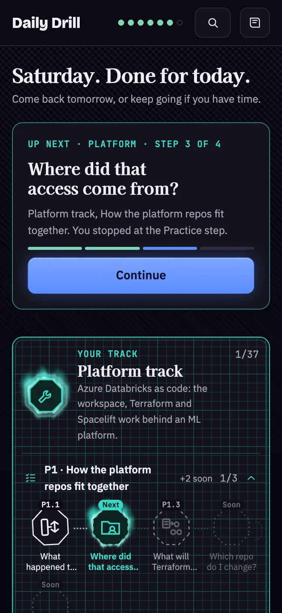 | 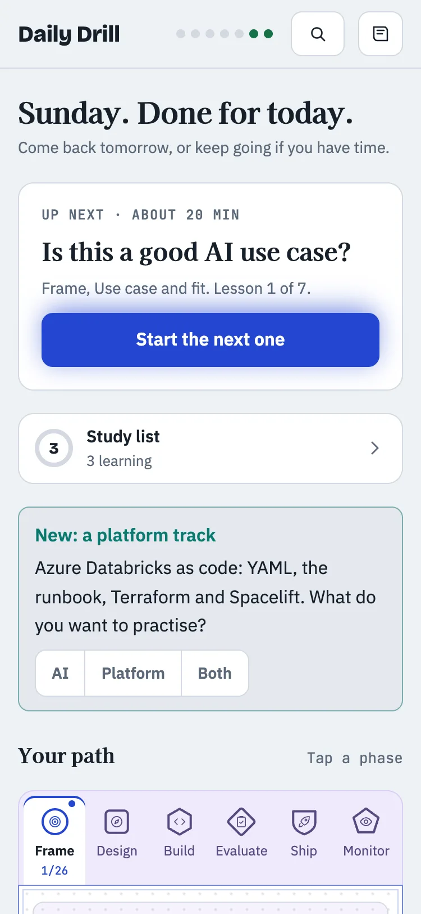 |

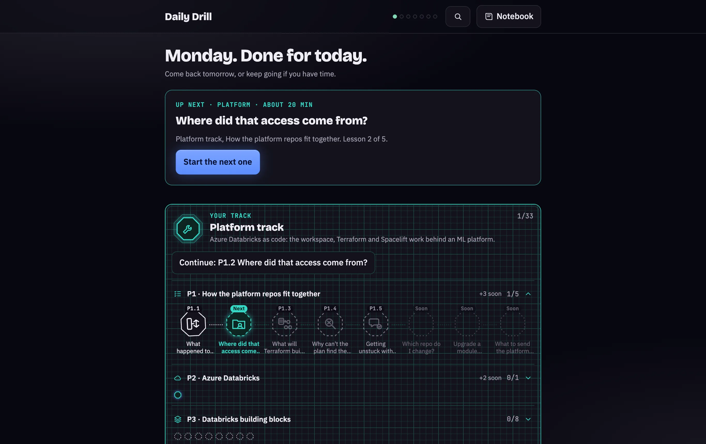

**What the learner sees.** The greeting, one card with the next lesson and one primary button,
then the path: six phase tabs on a violet strip, joined to the phase's room below. A first visit
shows "How it works" instead of the next lesson.

**What draws it.** `renderHome()` in the `home: the learning path` section; the tabs are
`railHtml(null, viewing)`; the card is `.next`. Colours: `--accent` for the button, `--path*` for the
strip.

**Change it safely.** Keep one primary button. New home sections go between `${upnext}` and
"Practice sets" in `renderHome()`. Text comes from the content (`D.lifecycle`), not the page.

## A phase room

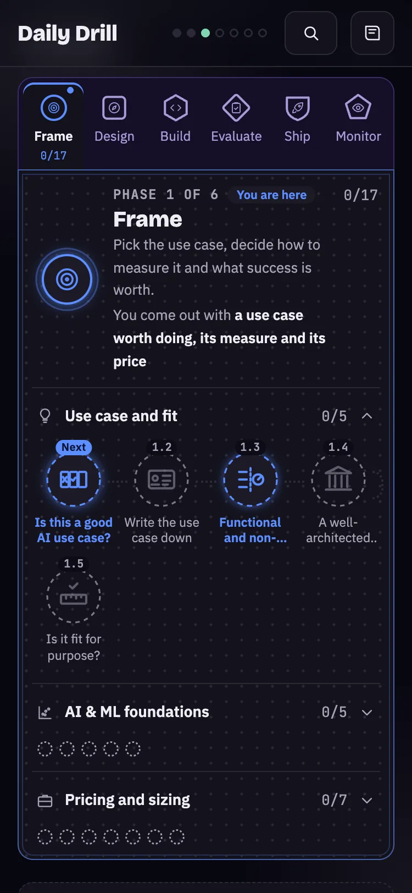

**What the learner sees.** The chosen phase as a room. At the top, a banner of line art: a
horizon for that phase (a gate, seals on a rope, a barrier being drawn, a closed curtain, the
barrier opening, lanterns at night) with blue-flame energy moving through it, and a cursed spirit
that gets weaker as you finish the phase's lessons: eyes close, it shrinks and cracks, and the
last lesson breaks it apart. On the left hill a white-haired, blindfolded hero drawn in glowing outline, in a long high-collared
jacket, grows in three stages as you finish the phase: calm with a hand at his blindfold and faint rings
(under a third done), two fingers raised to his lips in a sign, cyan rings round his shoulders and a red one lower (from a third),
arms open inside a field of stars, galaxies and great circles (from two-thirds). On top, a small touch for
the phase (a scanning ring, a line of energy, a blue and a red orb, measuring arcs, a beam, a quiet halo)
leaves from his hand. Tapping him lifts his blindfold: his eyes ignite blue and his aura flares, until
you tap him again (for this visit, `hzAwake`); tapping anywhere else fires at the spirit. The first time you see a finished phase (or the finished track), the hero takes his finishing
stance, charges and fires a blast across the banner, and the spirit breaks apart; after that the
room shows only the stain (`horizonFinale`, remembered on the device as `drill-hz-won`). Changing phase reshapes the hills; tapping the banner strikes the
spirit. The current phase's landmark is lit in blue. Then its shape glowing in the title card, what
you come out with, then one scene per module. The scene with the next lesson is open; the
others fold to a row of small shapes.

**What draws it.** `phasePage()` (scenes, `sticker()`, `minis()`), `.book.room`, `.paperN` (each
phase has its own paper), `badgeSvg()` for the title shape. The banner is `horizonHtml()` /
`horizonDraw()` in `page/horizon.js`, styles in `page/horizon.css`.

**Change it safely.** A new phase is a content change (`LIFECYCLE` in `modules/__init__.py`) plus
a shape in `phShape`, a paper, and a banner scene (one entry each in `HZ`, `HZ_ENERGY`, `HZ_AT`).
The six-phase count is tested. The banner is decorative: keep it `aria-hidden`, its colours tokens
(`--path`, `--accent`, `--fx-*`), and its art original line art.

## The Platform track

| Phone, Dusk | Desktop, Light |
|---|---|
| 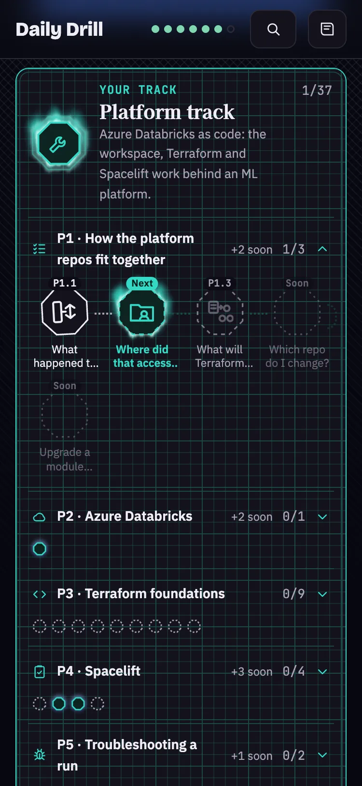 | 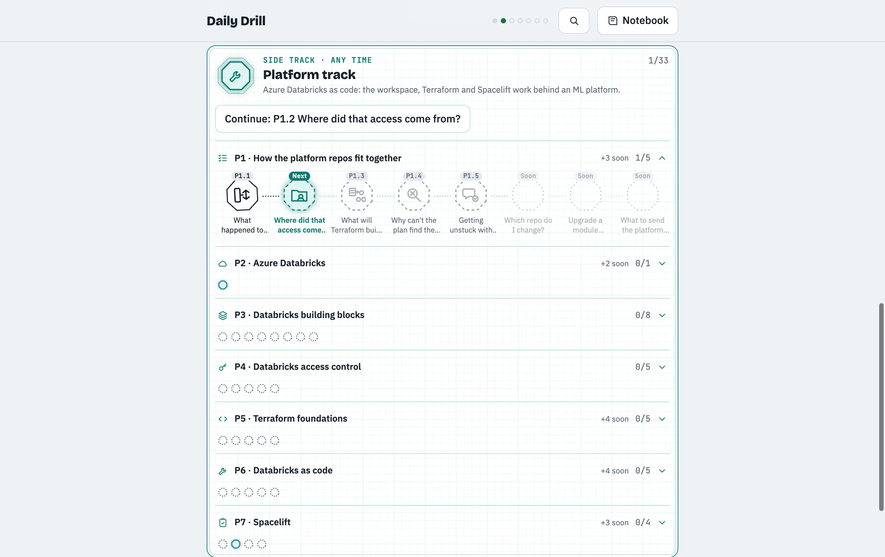 |

**What the learner sees.** A teal side track under the path: the same room design on blueprint
paper, octagon stickers numbered P1.1, and faded "Soon" stickers for lessons not written yet.
It never moves the path's next lesson.

**The banner.** The same battle in teal: a stack of workspaces, a pipeline, and an octagon ward
(the track's shape) that closes a little more with every lesson until the spirit is sealed and
broken. The track has its own spirit, the drift stack: three crooked boxes like workspaces that no
longer match their config, with loose cables for arms (`hzDriftStack()`). `hzTrackScene()` in `page/horizon.js`; the teal comes from `--hz-ink: var(--track)`.

**What draws it.** `trackPage()`, `TRACKS`, `trackOf`, `.book.room.track`, `.paper6`, `.stk.soon`;
teal comes from the `--track*` tokens.

**Change it safely.** Add modules to the track in `TRACKS` (`modules/__init__.py`). Placeholders are
`planned(...)` in the module file. Keep teal for the track only.

## A lesson: Learn

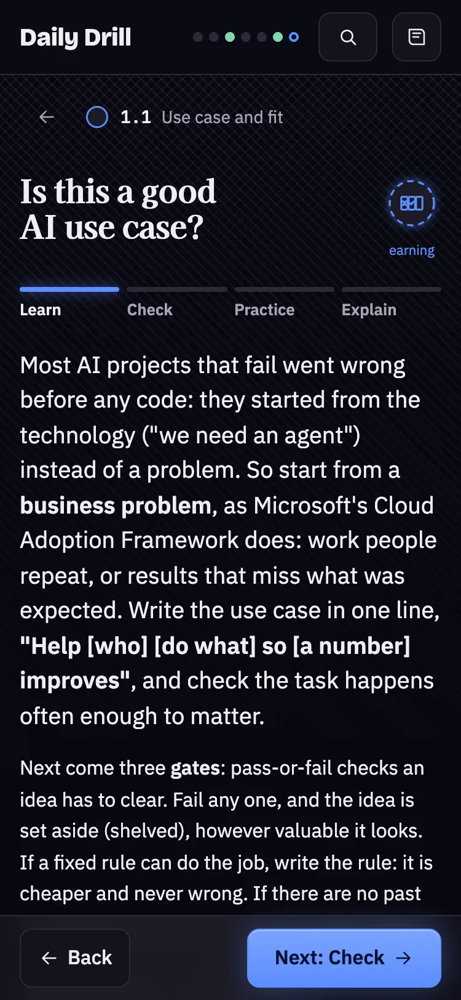

**What the learner sees.** One line saying where they are (back, the phase's shape, "1.1 Use case
and fit"), the title and the sticker they'll earn, the four-step stepper, then the lesson text and
its example.

**What draws it.** `openLesson()` → `lessonBar()` for the line, then `setStep(0)` → `learnPane()`;
the stepper and bottom bar are `setStep()` and `renderFoot()`. Styles `.lessonbar`, `.lb-shape`,
`.lb-t`.

**Change it safely.** Lesson words live in `modules/<module>.py` (`learn=`, `example=`). The
bottom bar has one primary button, "Next".

## A lesson: a trust mark

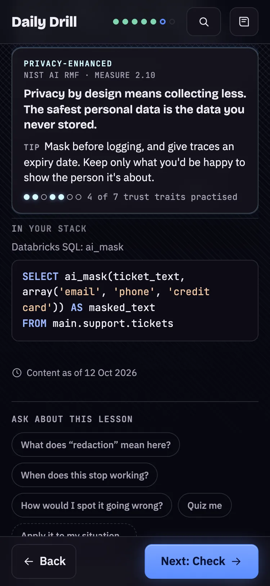

**What the learner sees.** A small ember right after the words where the lesson touches
responsible AI, privacy or governance. Tapping it opens a tooltip: the trustworthy-AI trait, the
NIST AI RMF reference, a perspective, one tip, and seven dots for the traits practised so far.
Unopened marks give off embers until they're opened.

**What draws it.** `learnPane()` calls `withTrust()` for each paragraph, which places
`trustMarkHtml()` after the note's phrase and adds `trustPopHtml()`; `openTrust()` and
`closeTrust()` run from their own click and Escape listeners in the `trust marks` section.

**Change it safely.** The notes are `content/trust.py`, one per lesson at most; the phrase must
appear once in the Learn text (a test checks). Colours are `--mark` and `--mark-glow`.

## A lesson: a diagram

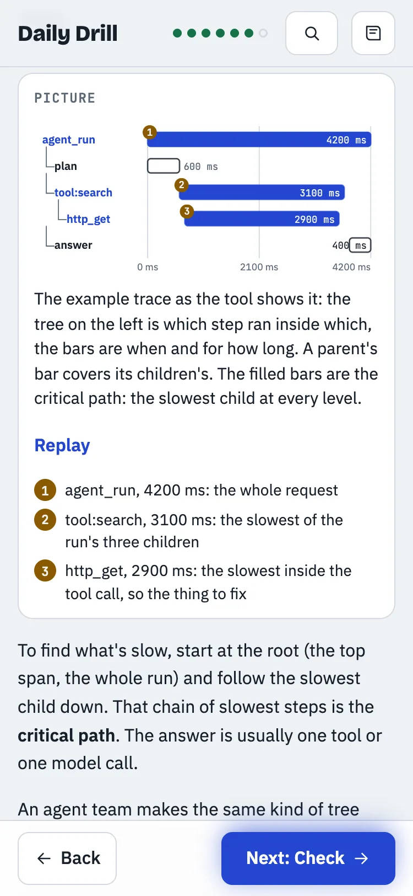

**What the learner sees.** One picture in the Learn step, drawn from the lesson's own example:
here the trace from Reading agent traces as the tool shows it, a tree on the left and time bars to
scale on the right, the critical path filled in blue. A caption and amber-numbered notes under it
say the same thing in words.

**What draws it.** `learnPane()` places `diagramHtml(L.diagram)` after the paragraph the data
names; one `dg<Kind>()` function per kind in the `lesson diagrams` section draws the SVG. Some
pictures step through on Back and Next (`steps`), some play once (`play`), some are a before-and-
after pair, and in Build `livePic()` draws the same kind from what your function returned.

**Change it safely.** The data is `content/diagrams.py`, one per lesson at most; every label must
appear in the lesson's words (a test checks). Colours are `accent` and `hint` only.

## A lesson: a sticker callback

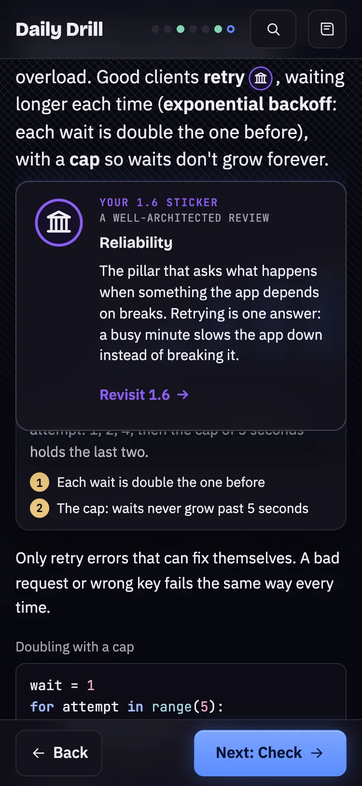

**What the learner sees.** Where a lesson uses an idea taught earlier, the sticker from that
lesson sits right after the phrase, here the 1.4 sticker after "Good clients retry". Tapping it
opens a card: the idea (Reliability), what it means here, and a way back to 1.4. A sticker not
opened yet glows softly; one from a lesson not done yet is a dashed outline that offers the lesson.

**What draws it.** `withTrust()` places `cbMarkHtml()` after each callback's phrase and adds
`cbPopHtml()` under the paragraph; `openCb()` and `closeCb()` run from the `sticker callbacks`
section's own listeners.

**Change it safely.** The data is `content/callbacks.py`, one or two per lesson, each pointing
to an earlier lesson (a test checks). Colours are `--path`, or `--track` for the Platform track.

## A lesson: Look again

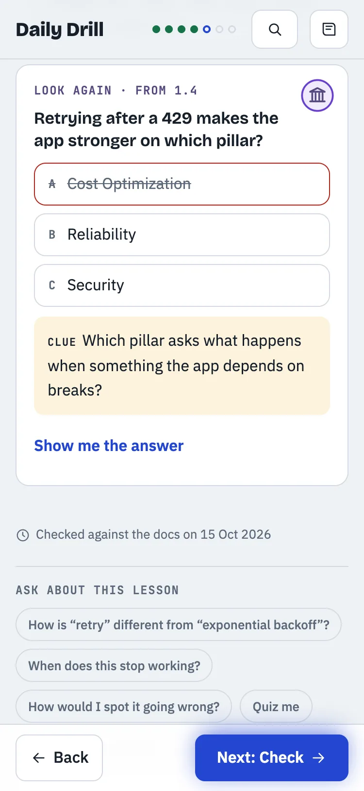

**What the learner sees.** After Learn, one question that uses the earlier idea. A wrong pick is
crossed out and the clue shows, with "Show me the answer" below; right on your own lights the
sticker in the corner. It never changes the result card.

**What draws it.** `learnPane()` adds `againHtml()` after the example; picks go through
`againStep()`, which saves `lp(id).again` and redraws just the card.

**Change it safely.** The question is the `again=` of a callback in `content/callbacks.py`,
written with `ask(...)`: three options and a clue.

## A lesson: Check

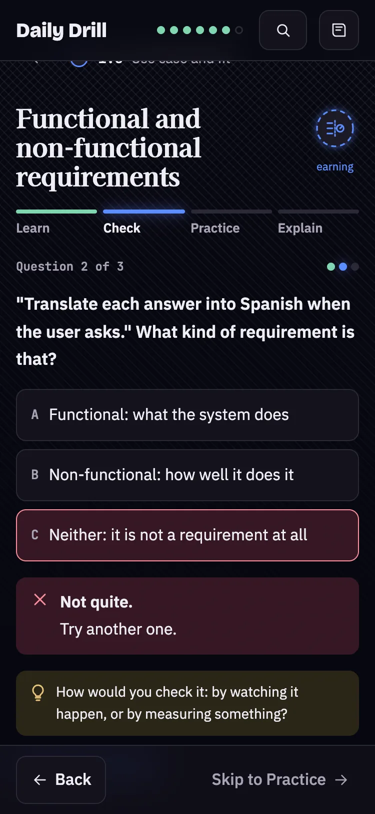

The hero's round portrait sits beside the clue and the verdict (`hzCoach()` in `page/horizon.js`):
blindfolded for a clue, and with the blindfold pushed up and his eyes glowing cyan when he gives the answer.
The words stay the lesson's own. The same portrait shows in Explain and Practice, and the done screen has
him in full, in the phase's stance.

**What the learner sees.** Up to three multiple-choice questions, one at a time ("Question 1 of
3"). A wrong pick is crossed out and they try again; help is a clue, then the answer. Once a
question is right, the reason shows and the tutor offers "Why not ...?" and "Give me a harder one
like this" (not before: it would give the answer away).

**What draws it.** `checkPane()` with `checkQs()`; answers are `checkPick`, `checkHelp`, `checkNext` (`data-opt`, `data-chk-help`, `data-chk-next` in the `events` section); the
tutor chips are `askPanel()`, and the tutor gets `askContext()`, which includes the module's
`setting`.

**Change it safely.** Question 1 is `question(...)` in the lesson; questions 2 and 3 are `ask(...)` in `content/checks/<module>.py`, with the writing rules at the top of `content/checks/__init__.py`. Keep exactly one right answer
and a plain `why`.

## A lesson: Build (code)

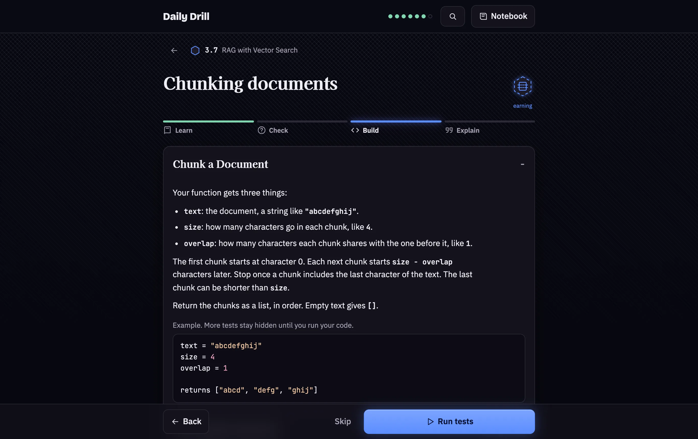

**What the learner sees.** The task, a fill-in-the-blanks scaffold (or a blank start), Run tests
in the bottom bar, hints that go step by step, and a Learn panel with the ideas it needs.

**What draws it.** `loadProblem()` and the `build step`, `hints, review, solution` and `editor`
sections; the code runs in the browser with Skulpt (`Python literals and test harness`).

**Change it safely.** Everything about an exercise is `exercise(...)` in the lesson.
`drill build-page` fills each scaffold's blanks with `fills` and runs the tests, so they can't
drift apart.

## A lesson: Explain

| Gaps, with a clue (Dusk) | Finished (Light) |
|---|---|
| 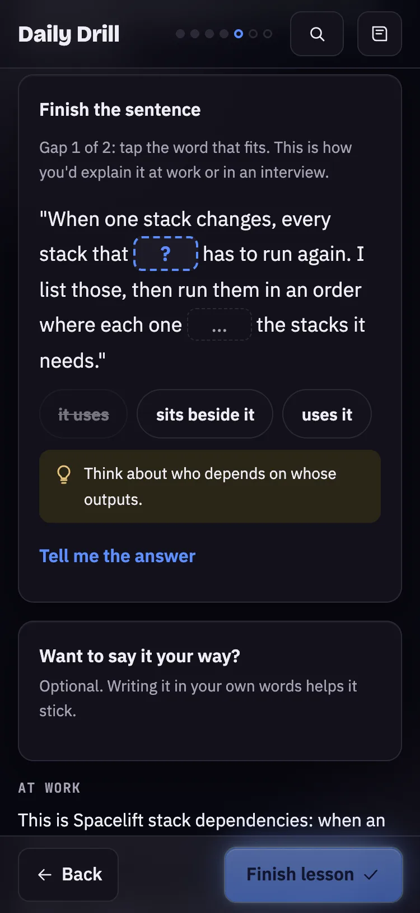 | 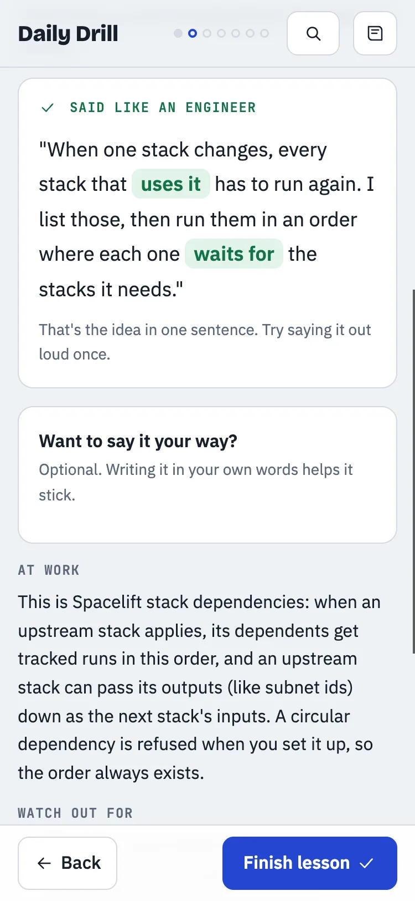 |

**What the learner sees.** The lesson's sentence with two or three gaps, filled one at a time from
three words. A wrong word is crossed out; "Give me a clue" comes first, then "Tell me the answer".
Writing it your own way is optional, underneath.

**What draws it.** `clozeHtml()`, `clozePick()` and `CLZ` in `step panes`, inside `anglePane()`;
styles `.cloze`, `.gap`, `.clzchip`, `.clzclue`.

**Change it safely.** The sentence and its gaps are `angle(say=...)`, written
`[[answer|wrong|wrong::clue]]`. It must sound like a person talking (see [../PAGE.md](../PAGE.md)).
Tests check every gap.

## Learn as picture cards

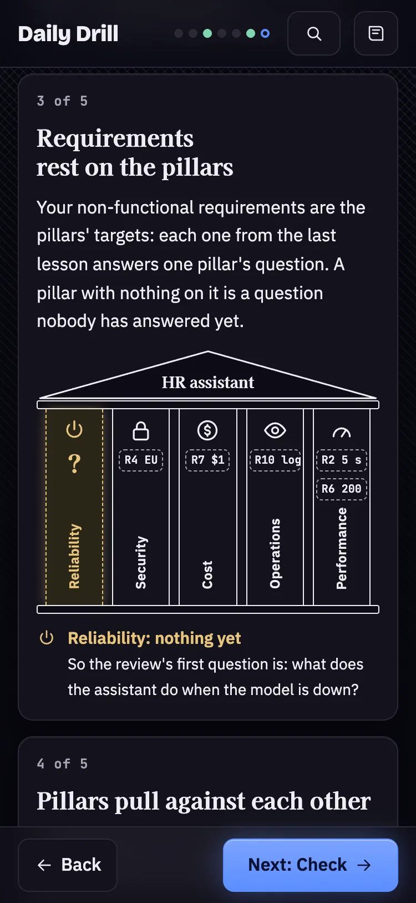
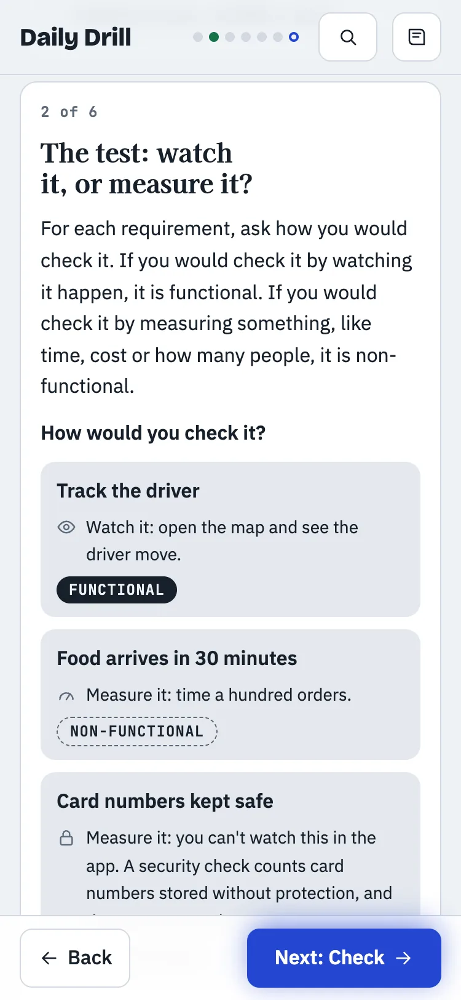

**What the learner sees.** Lessons 1.3 (functional and non-functional requirements) and 1.4 (a
well-architected review) teach Learn as short cards, one idea and one picture each: two piles of
functional and non-functional requirements, the watch-or-measure test, a sentence cut in two, vague words rewritten, five pillars with
the requirements resting on them (an empty one marked "?"), a see-saw for a trade-off, and the
steps from a model's draft to a person's decision.

**What draws it.** `cardsLearnPane()` and `PC_PIC` (one function per kind of picture) in
`page/cards.js`; styles `.pc-*` in `page/cards.css`. `learnPane()` hands over when the lesson has
`cards`. The content is `cards=[card(...)]` in the lesson ([../PAGE.md](../PAGE.md), "Picture cards").

**Change it safely.** Each picture is also written in words for the tutor and the MCP tools
(`picture_text`), and a test fails if a card names an icon the page doesn't have. Tell two kinds
apart by `look` (solid or dashed), never by a new colour.

## A walkthrough of a tool's screens

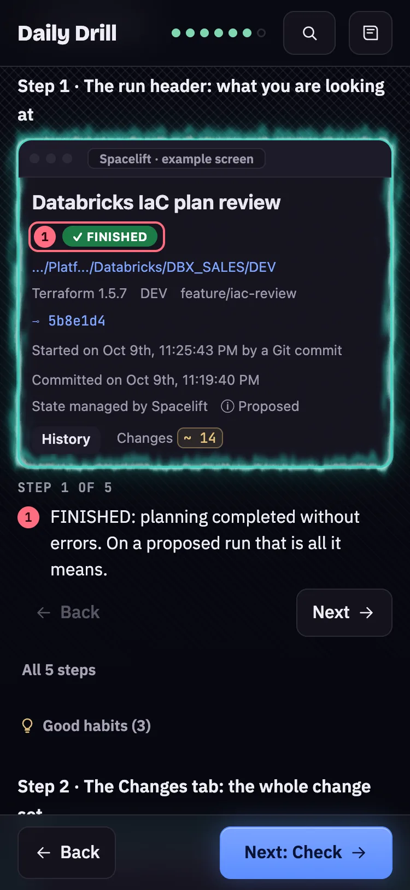

**What the learner sees.** In "Reading a Spacelift run", the real screens of a Spacelift run
(header, Changes tab, planning log, plan diff, run history) redrawn in the app's look, so they fit a
phone and follow the theme. Numbered callouts in the hint colour match the numbered steps under
each screen, followed by "Good habits" tips.

**What draws it.** `walkHtml()` and `SL_VIEW` (one function per kind of screen) in the
`walkthrough` section; styles `.sl-*`. The content is `walkthrough=[screen(...)]` in the lesson.

**Change it safely.** Each part with `"n": 3` needs step 3; `screen()` fails at build time if the
numbers and steps don't match. A new kind of screen needs a renderer in `SL_VIEW` (a test checks).

## Finishing a lesson

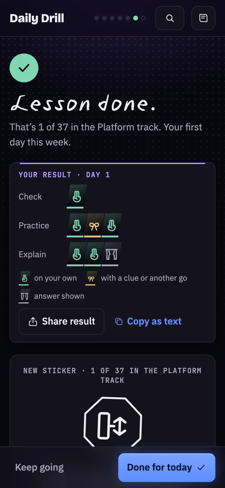

**What the learner sees.** A check, how far they are in the phase or track, their result to
share (a mark for each step, the first time through), the new sticker, what they did in the
lesson, and what's next. "Done for today" is the primary button; Share result is quiet.

**What draws it.** `showDone()` in `views`, reached from `goNext()` on the last step; the result
card is `resultHtml()` in `page/share.js`.

## A lesson: Practice questions

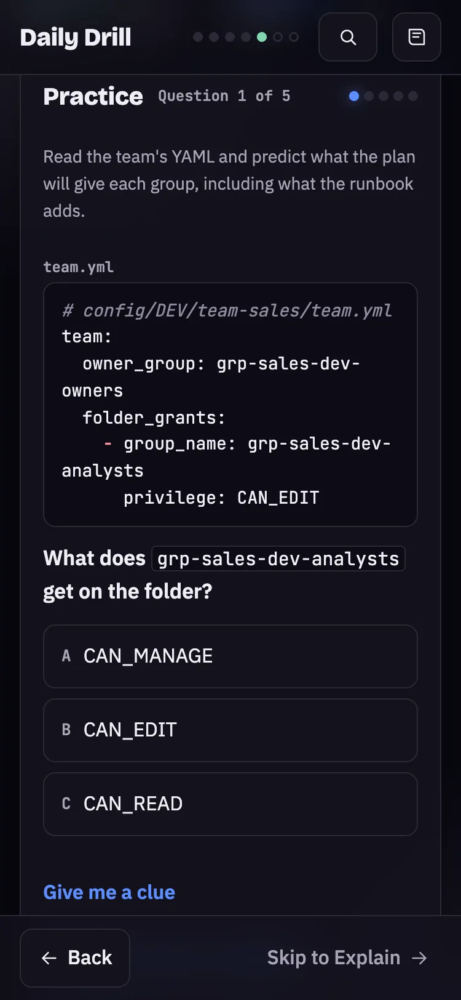

**What the learner sees.** In lessons whose skill is a decision or reading evidence (which compute
for this work, is the pilot fit for purpose, what a plan really does), the step is called Practice
and is a short run of questions instead of code:
a piece of evidence (a YAML file, a chain of stops, a plan, a claim, a prompt), then one plain
question with two to four answers, in a fixed shuffled order. "Give me a clue" comes first, then the answer; the dots show how far
along they are. Some questions are "Fix the YAML": edit the file until it passes. Python stays
one tap away.

**What draws it.** `qfRender()`, `qfPick()`, `qfHelp()` and `QF` in the `practice questions` section; Fix the
YAML is `yamlRead()` and `yamlCheck()`, mirrored in Python by `content/yaml_rules.py`. The content
is `exercise(practice=practice(asks=[ask(...), fix(...)]))` in the lesson.

**Change it safely.** One question per screen, clue before answer. Each `ask` needs exactly one
right answer and a `clue`, and the right option mustn't be much the longest; a `fix` needs a start
that fails and an answer that passes (tests check all three).

## The study list

| On Home | Opened |
|---|---|
| 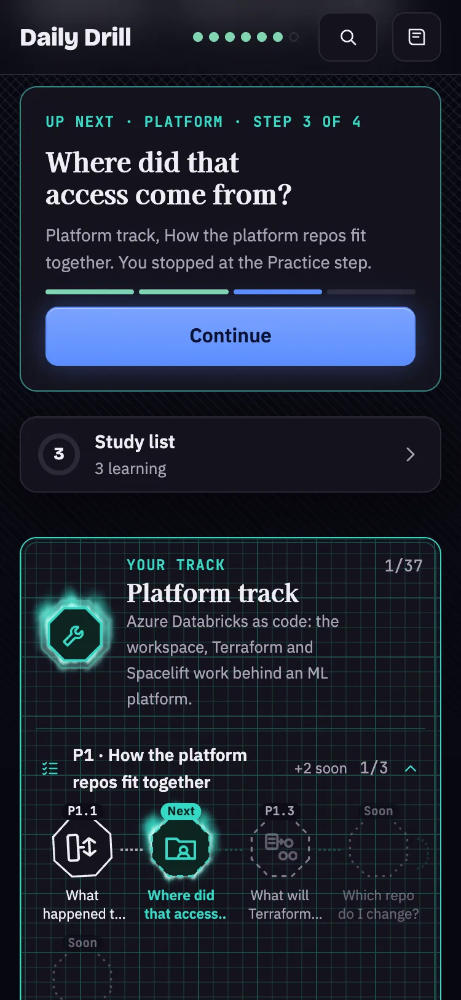 | 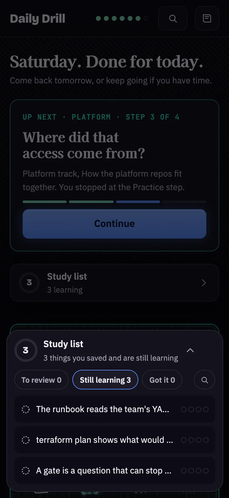 |

**What the learner sees.** Closed, one quiet row under the Today card: a ring with a count and
"3 learning · 2 to review". It never floats over a lesson or pulses. Tapping it opens the sheet:
everything they saved, in three tabs (To review, Still learning, Got it), with seals for each
spaced review. Due reviews also show as one line on the Today card ("Also: 2 quick reviews").

**What draws it.** `studyRowHtml()`, `renderPocket()` and `openPocket()` in
`page/study-list.js`; styles `.studyrow`, `.reviewline` and `.pocket` in `page/pocket.css`. Saved
items come from the backend (`study` docs).

**Change it safely.** Keep it out of the lesson screens: it appears when asked for. The row is
hidden when nothing is saved.

## The Notebook

| Results (Dusk) | Settings (Light) |
|---|---|
| 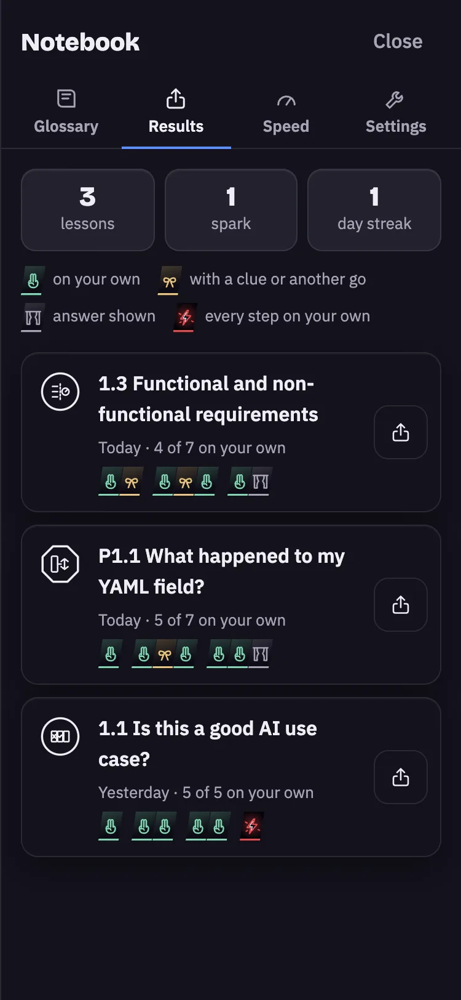 | 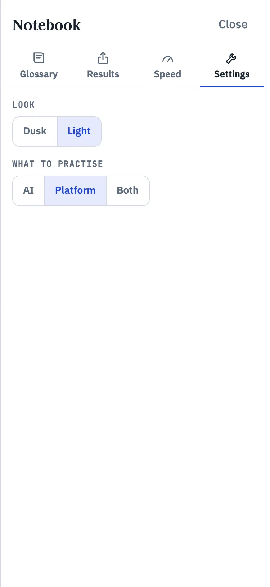 |

**What the learner sees.** The Notebook button in the top bar slides a drawer over the page with
four tabs: Glossary, Results, Speed and Settings. Results starts with three numbers (lessons
finished, sparks, the day streak) and the key to the marks, then one row per finished lesson,
newest first: its sticker, the lesson number and title, when it was finished ("Today",
"Yesterday", or the date), "7 of 8 on your own", and the marks themselves; the share button on a
row copies that result's picture. Settings has two choices, each a segmented control: the Look
(Dusk or Light) and What to practise (AI, Platform or Both). Lessons finished before results
began are not listed, and the empty tab says so.

**What draws it.** The drawer is `<aside class="drawer" id="drawer">` in `page.html`, opened by
`openNotebook(tab)` and closed by `closeNotebook()` in `page/notebook.js` (it is a dialog: Tab stays
inside it, and the tabs take the arrow keys). The Results tab is `renderResults()` in
`page/share.js`, built from `resultOf()`, `resultScore()` and `whenFinished()`; its styles are
`.resstats` and `.resitem` in `page/share.css`. Settings is the two `.setting` rows in the drawer
markup: `data-theme-pick` runs `applyLook()`, `data-focus-pick` runs `setFocus()`. Drawer styles:
`.drawer`, `.tabs`, `.setting` in `page/notebook.css`.

**Change it safely.** A new tab needs both a `nbtab-<name>` button and an `nb-<name>` pane (a test
checks the pair). Keep Results honest: a step done before marks existed says "Done earlier"
rather than guessing a mark.

## Search landing

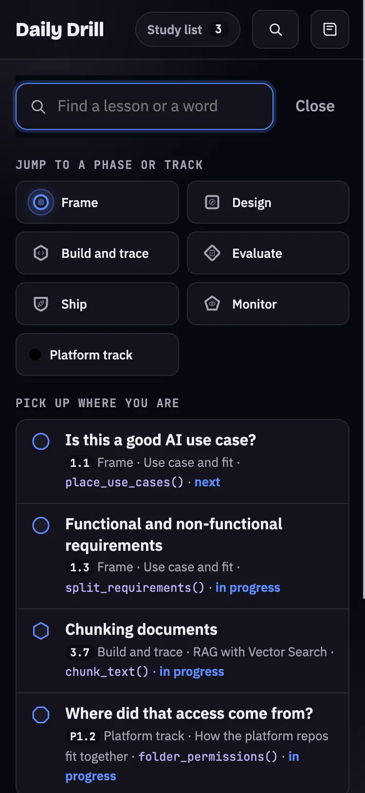

**What the learner sees.** Search opened with an empty box: "Jump to a phase or track" (one chip
per phase, with the phase's shape, and a teal octagon for the Platform track), "Pick up where you
are" (today's lesson and up to three lessons started but not finished), then a few words to try.
The box already has the keyboard.

**What draws it.** `openSearch()`, then the empty-box branch of `renderSearch()` in `search:
lessons, glossary words and the study list`: `.sphases` with `.sphase` and `.strack` chips,
`lessonHit()` rows, and `data-try` chips. The words to try follow `progress.focus`.

**Change it safely.** Keep it a starting point, not a second Home: three short groups. The track's
chip stays teal (`.strack .sh.pl`).

## Search


**What the learner sees.** One box that finds lessons, glossary words and study-list items, with
the matching words marked. The picture shows the results for "leakage": the glossary word first,
with "Where it's taught", then the lessons that use it.

**What draws it.** `renderSearch()` in `search: lessons, glossary words and the study list`; the
index is `SEARCH_INDEX`, rows are `lessonHit()`, matches are marked by `hiTerms()`. Styles `.sgrp`,
`.slist`, `.shit`, `.sword`.
